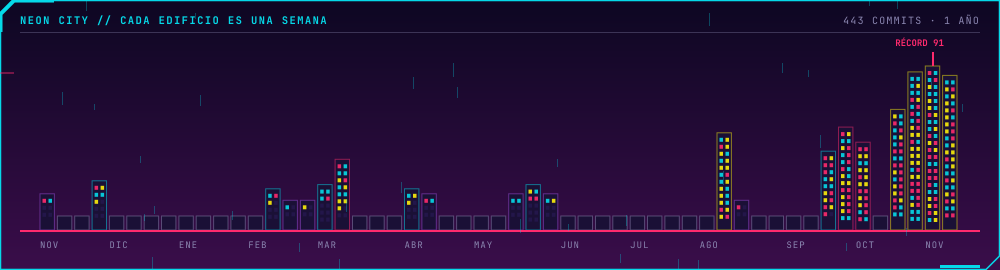

<code>« enciende la terminal, conecta los implantes y empieza la partida. »</code>

[personaje](#personaje) &nbsp;/&nbsp; [misiones](#misiones) &nbsp;/&nbsp; [todos los repos](https://github.com/NeckHurtttt?tab=repositories)

### Personaje

 

De día, la U. De noche, Night City... digo, la terminal. 
<b>No time to explain, just commit.</b>

### Misiones

 
 
 

 

 

