### 📼 Sinopsis

Estudiante de **Ingeniería en Sistemas**. El código también tiene sus calles: bugs, deadlines y commits a las 3 AM.

### 💿 Tracklist

| # | Track | De qué va | Producido con |
|---|---|---|---|
| 01 | [**AgroControl**](https://github.com/NeckHurtttt/AgroControl) | Gestión de lotes agrícolas: predios, parcelas, campañas, labores, insumos y cosechas. Arranca con Docker. | Java · TypeScript · PostgreSQL |
| 02 | [**tema-switcher**](https://github.com/NeckHurtttt/tema-switcher) | Recolorea todo el escritorio niri de una vez, con fondo animado por tema. | Python |
| 03 | [**ESTRUCTURA-DE-DATOS-1**](https://github.com/NeckHurtttt/ESTRUCTURA-DE-DATOS-1) | Tareas de estructuras de datos. | C++ |

### 🎚️ Créditos

### 🎧 *"Be humble... but push tu último commit"*

